# GZCLP tracker

An Android workout tracker with six programs: GZCLP (4 days, A1, B1, A2, B2), Bro split (5 days), Push, pull, legs (6 days), Upper, lower (4 days), Full body (3 days), and Chest, back, legs (3 days). GZCLP runs its T1, T2, and T3 progression with stage changes and resets. Every other program runs a 3-week cycle per exercise: 3×12, then 3×10 one step heavier, then 3×8 two steps heavier, then back to 3×12 at 5 lb over the last cycle's base if every heavy set reached 8.

The app logs a weight and reps for every set, shows the next eight workouts and a month of past ones, charts each exercise's top set and estimated 1RM, tracks body weight (each morning's first weigh-in, a 7-day average, and a daily reminder set in Settings) so each lift can also chart its estimated 1RM as a multiple of body weight, and runs a rest timer that vibrates with the screen off. A Food tab keeps a photo food log: take a photo of each meal, or upload one from the gallery, and it is saved at the time the photo was taken (you confirm or set the time when an uploaded photo has none or it is in the future or over a week old), with no macros or calories, and you can page back through past days. Meal photos never leave the phone and are never written to the synced folder. All data stays on the phone, except what you choose to write to Android Health Connect. The app mirrors its log to a folder you share with Syncthing. `docs/log-format.md` describes that log (version 2) for the desktop analysis app.

The Workout tab switches between Lifting and Cardio. Start one of 59 cardio activities, or one you type in, from a searchable list, or tap one of your last three to start it at once. A big clock counts up while you go, and an ongoing notification shows the time on the lock screen; the clock runs from the start time in the log, so locking the phone, closing the app, or rebooting keeps the session. Stop opens a sheet to fix the duration (hold − or +, or tap the end time to pick it), and to add an optional distance, RPE, and notes. Lifting and cardio run one at a time. The Cardio page shows this week's total against a weekly goal (2 hr 30 min unless you change it in Settings), the last four weeks as bars, quick-start rows, time per activity, and each session with its pace or speed.

History opens on a Monday to Sunday week you can page back through: gym and cardio time, the days you trained, cardio by activity, each lift against the same slot last cycle (the last time at that tier for GZCLP, the same week of the last cycle otherwise), the body-weight average, and the meal count, each against the week before. Its All tab is the full workout list.

## Screenshots

Rendered by the Roborazzi screenshot test (`ScreenShots.kt`) from its demo data.

| Next workout (Dark) | T1 warm-ups (Jade) | Swap an exercise (Light) |
| :---: | :---: | :---: |
|  | 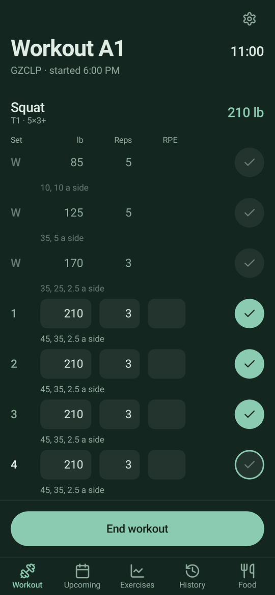 | 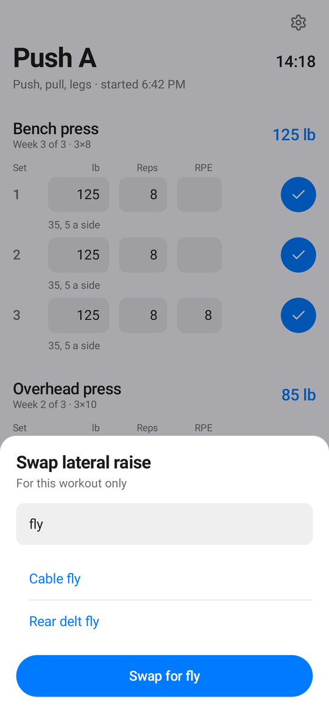 |
| **Exercise (Tokyo Night)** | **History (Light)** | **Body weight (Dark)** |
|  |  |  |
| **Food (Jade)** | **Settings (Tokyo Night)** | **Cardio (Dark)** |
| 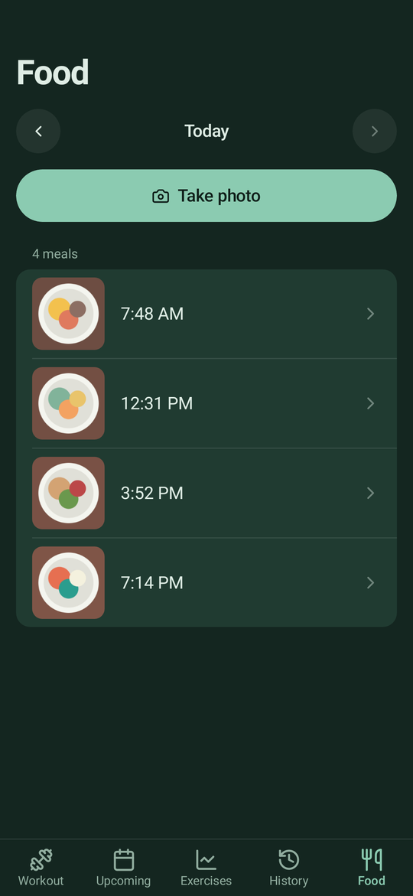 | 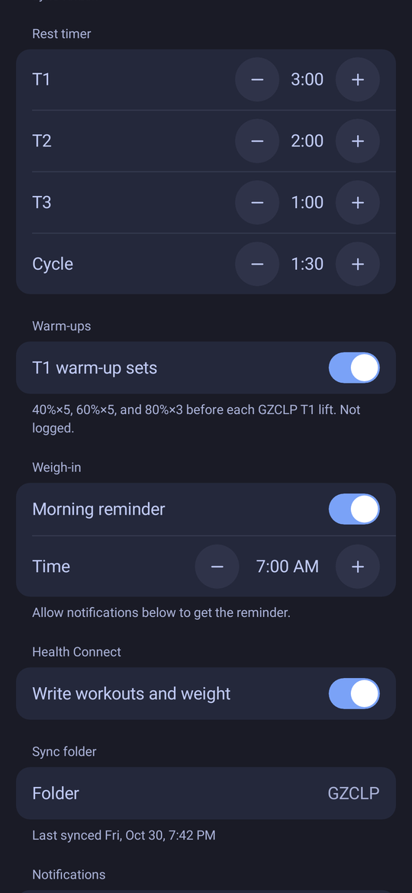 | 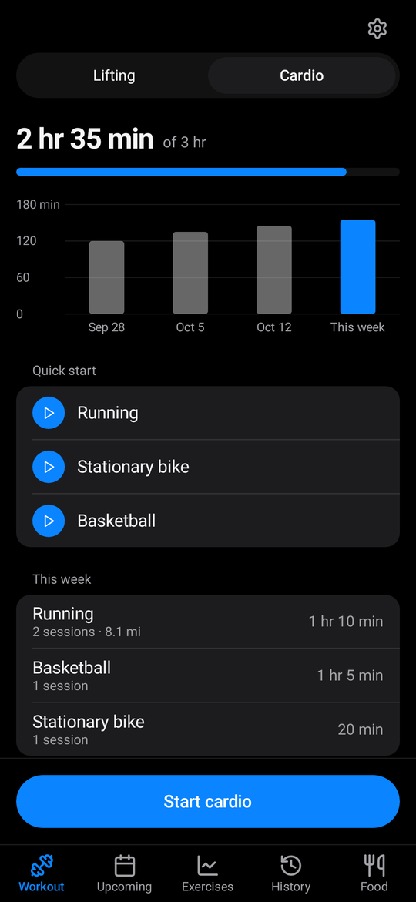 |

The workout in progress, with the rest timer, plates per side, and RPE, in each app theme and in the Laptop theme following eight Omarchy themes:

| Jade | Tokyo Night | Dark | Light |
| :---: | :---: | :---: | :---: |
| 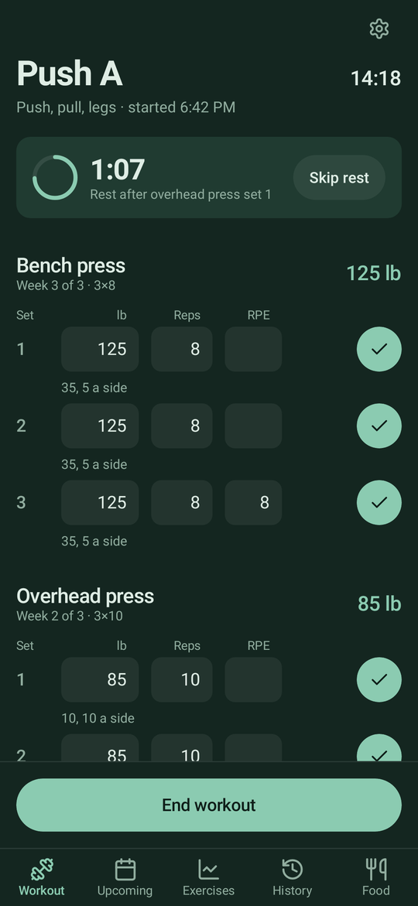 | 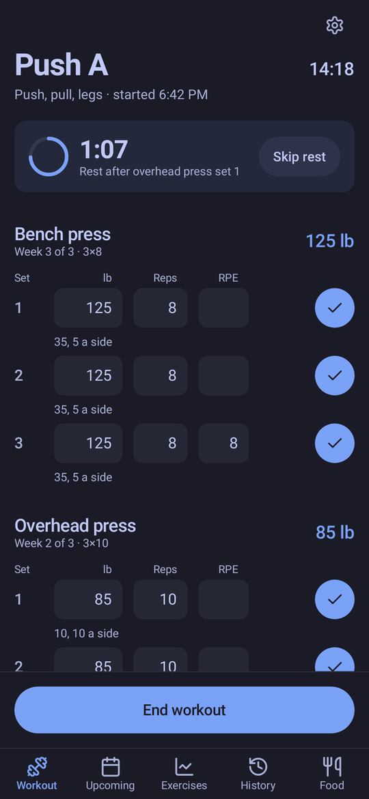 | 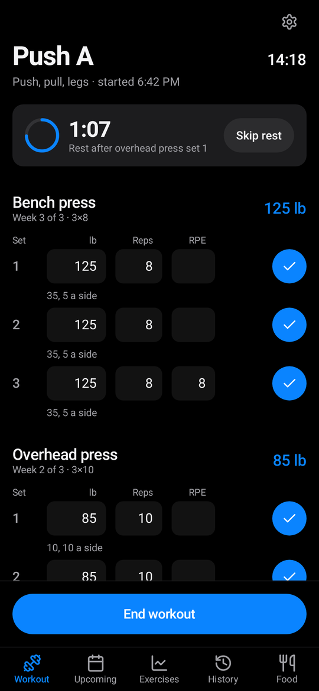 | 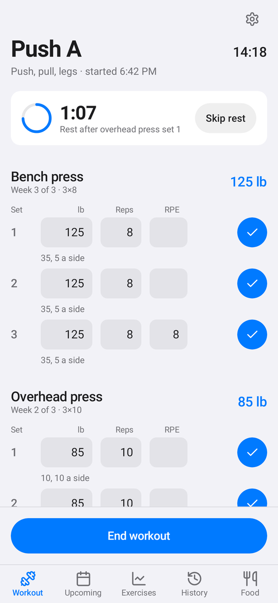 |
| **Laptop: Everforest** | **Laptop: Catppuccin Latte** | **Laptop: Rosé Pine** | **Laptop: City 783** |
| 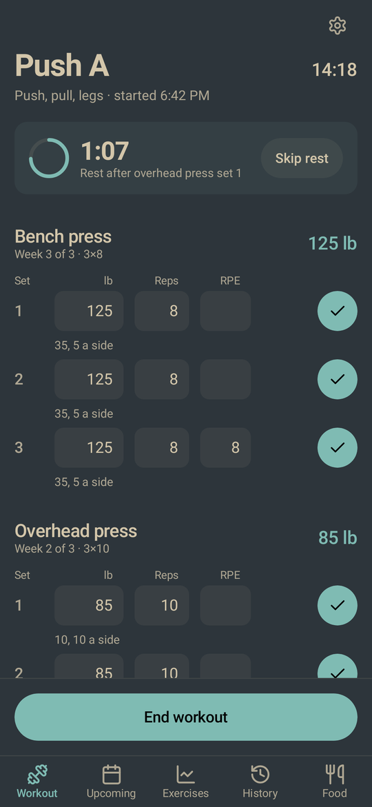 | 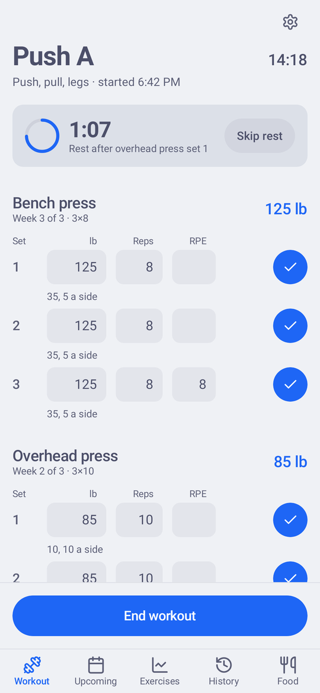 | 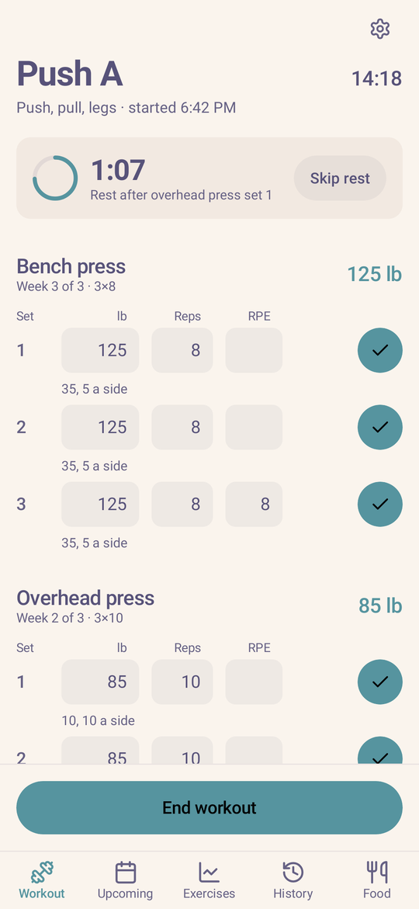 | 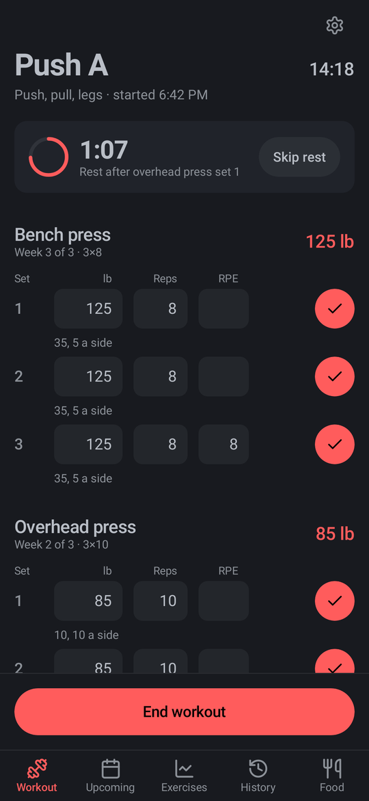 |
| **Laptop: Deep Ocean** | **Laptop: Desert Dusk** | **Laptop: Hackerman** | **Laptop: Miasma** |
| 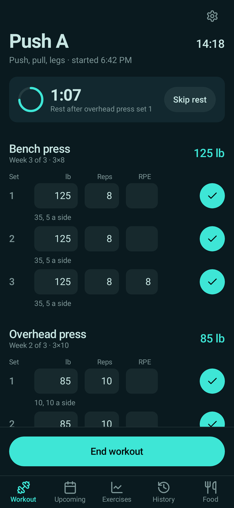 | 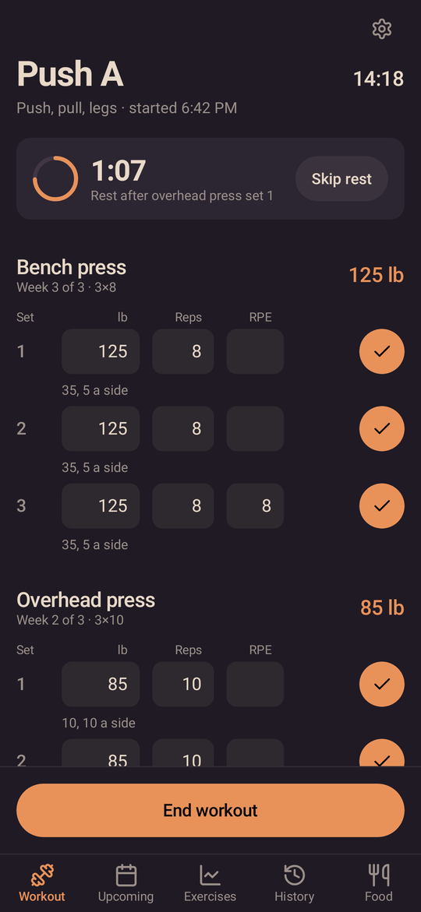 | 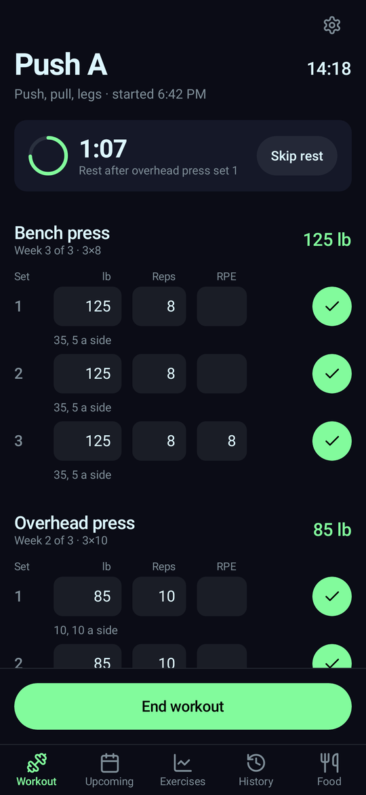 | 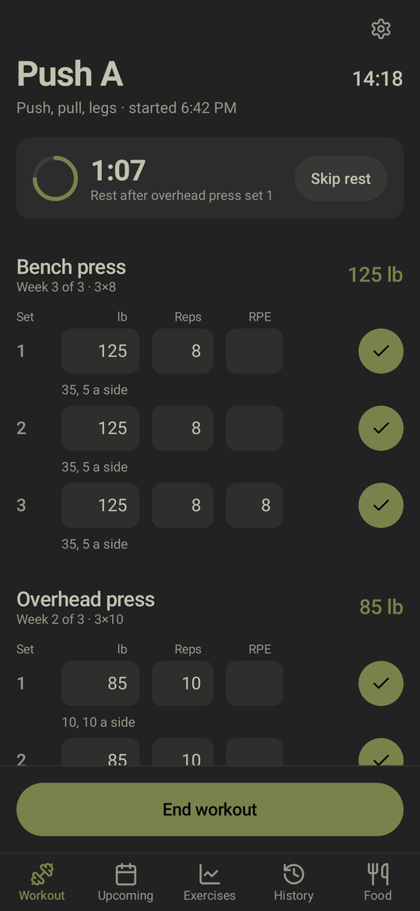 |

The desktop analysis app (`desktop/`) reads the synced log:


## Build

Requirements: JDK 21 and an Android SDK with `platforms;android-35` and `build-tools;35.0.0`. The Gradle wrapper downloads Gradle itself.

```bash
eval "$(mise env -s bash)"            # sets ANDROID_HOME on this machine
echo "sdk.dir=$ANDROID_HOME" > local.properties
./gradlew test                         # progression engine and log tests
./gradlew assembleDebug                # app/build/outputs/apk/debug/app-debug.apk
```

Screenshots of every screen in every theme:

```bash
./gradlew recordRoborazziDebug -PgzclpShots=/path/to/shots
```

## Install for friends

No cable or computer needed. The app needs Android 12 or later.

1. Install [Obtainium](https://github.com/ImranR98/Obtainium/releases) (download the APK from its releases page and open it; allow installs from your browser when asked).
2. In Obtainium, tap Add App, paste `https://github.com/ericxu1070/workout-tracker`, and tap Add. Then tap Install.
3. Obtainium checks for new versions and offers each update; tap Update to install it.

Without Obtainium, download the APK from [Releases](https://github.com/ericxu1070/workout-tracker/releases) and open it; you then install updates by hand the same way.

On first launch, enter your 5-rep maxes and pick a program (see First run below). The sync folder and Health Connect are optional: without them everything stays on your phone and works the same. A sync folder only matters if you want a copy of your log on a computer through Syncthing.

## Release

Pushing a tag like `v2.1` runs `.github/workflows/release.yml`: it builds the release APK signed with the release key, sets `versionName` from the tag and `versionCode` from the commit count (so every later tag on `main` is a higher version), and publishes a GitHub Release with the APK attached. Merging to `main` publishes nothing.

```bash
git tag v2.1 origin/main && git push origin v2.1
```

The key lives in `~/.local/share/workout-tracker-release/` (keystore, password, notes) and in the repository's Actions secrets `RELEASE_KEYSTORE_BASE64`, `RELEASE_KEYSTORE_PASSWORD`, `RELEASE_KEY_ALIAS`, and `RELEASE_KEY_PASSWORD`. Back that folder up: Android installs an update only when it is signed with the same key, so a lost key means everyone uninstalls and starts over. To publish into another repo, set the repository variable `RELEASE_REPO` to `owner/name` and the secret `RELEASE_TOKEN` to a token that can write that repo's contents.

To build a signed APK locally, set `RELEASE_KEYSTORE` to the keystore path and the three other variables to the same values, then run `./gradlew assembleRelease`. Without `RELEASE_KEYSTORE`, release builds are unsigned and debug builds are unchanged.

## Install from a computer

Enable USB debugging on the phone, connect it, then:

```bash
adb install -r app/build/outputs/apk/debug/app-debug.apk
adb shell am start -n dev.gzclp.tracker/.MainActivity
```

## First run

1. Enter a 5-rep max for each main lift and pick a program. GZCLP starts T1 at 85% and T2 at 65%; the cycle programs start week 1 at 65%. All rounded to 5 lb. Other exercises ask for a starting weight the first time they come up.
2. In Settings, choose the sync folder (for example `Documents/GZCLP`) and share it with Syncthing. The app writes `gzclp-log.jsonl` there. If the laptop also syncs `omarchy-theme.toml` into that folder, the Laptop theme in Settings follows it; the app reads that file and never writes it.
3. Allow notifications when asked, so the rest timer can alert you with the screen off and the 7:00 AM weigh-in reminder can reach you.

After a reinstall, tap Restore log on the first screen and pick the same folder.

To send workouts, cardio, and weigh-ins to Health Connect, turn on Health Connect in Settings and allow access. From then on, each finished workout becomes a strength-training session (one segment per set with its reps, every set's weight in the notes), each finished cardio session becomes an exercise session of its activity's type (distance, pace or speed, and RPE in the notes), and each weigh-in becomes a weight record; editing or deleting a cardio session or weigh-in updates Health Connect too. The app only writes and never reads. Workouts, cardio, and weigh-ins from before you turned it on are not sent. Without Health Connect, or with access denied, everything else works the same.

In Settings you can switch programs (history and each exercise's progress carry over), add or remove exercises per workout, and change the cycle steps (5 lb upper body, 10 lb lower body, 5 lb per new cycle by default), and set your bar and plates (a 45 lb bar; pairs of 45, 35, 25, 10, 5, and 2.5 lb plates by default). Barbell lifts round each target to the nearest weight those plates make, and every set shows the plates for one side. Progression still counts from the program's own weight.

Version 2 reads only version 2 logs. On first launch it sets an older local log aside as `gzclp-log.jsonl.old`; uninstall first for a clean start.

## Layout

- `engine/` holds the program table, the GZCLP progression, and the 3-week cycle, as pure Kotlin.
- `log/` holds the event log, its JSON codec, the state fold, the commands that turn taps into events, the per-exercise stats, and the weekly summary.
- `sync/` mirrors the log into the shared folder.
- `rest/` holds the rest alarm and its notifications.
- `cardio/` holds the notification for the cardio session in progress.
- `remind/` holds the daily weigh-in reminder.
- `food/` keeps the meal photos in app-private storage, one JPEG per meal named for its time.
- `health/` turns finished workouts, cardio sessions, and weigh-ins into Health Connect records, and holds the privacy note Health Connect shows.
- `ui/` holds the Compose screens and the four color themes.
