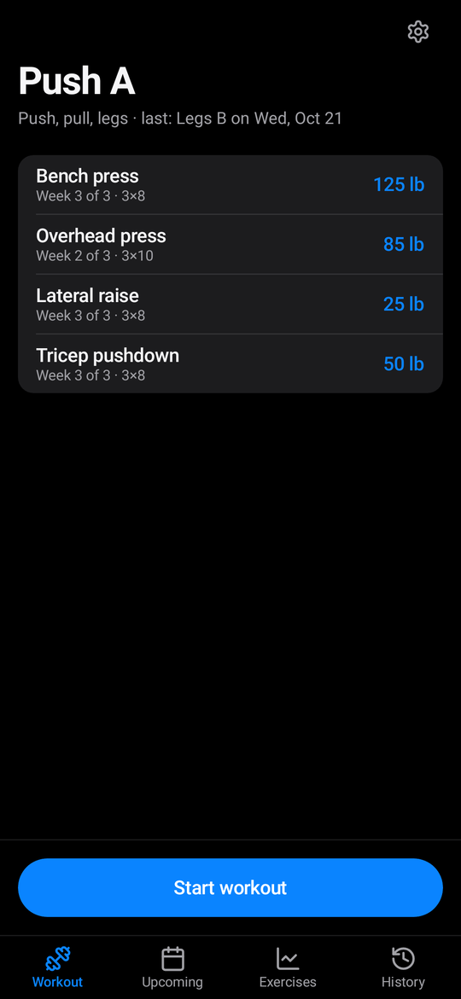
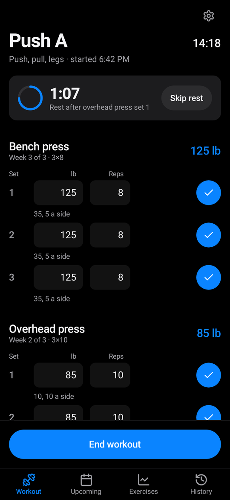
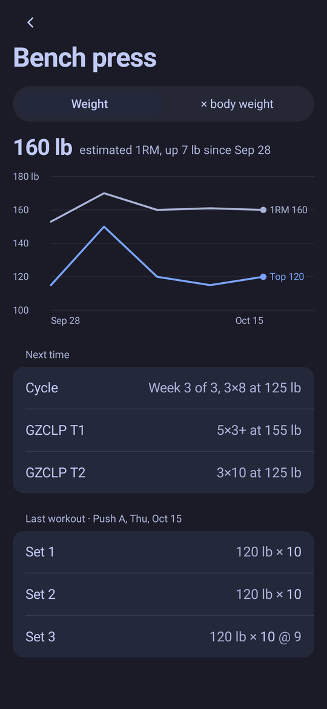
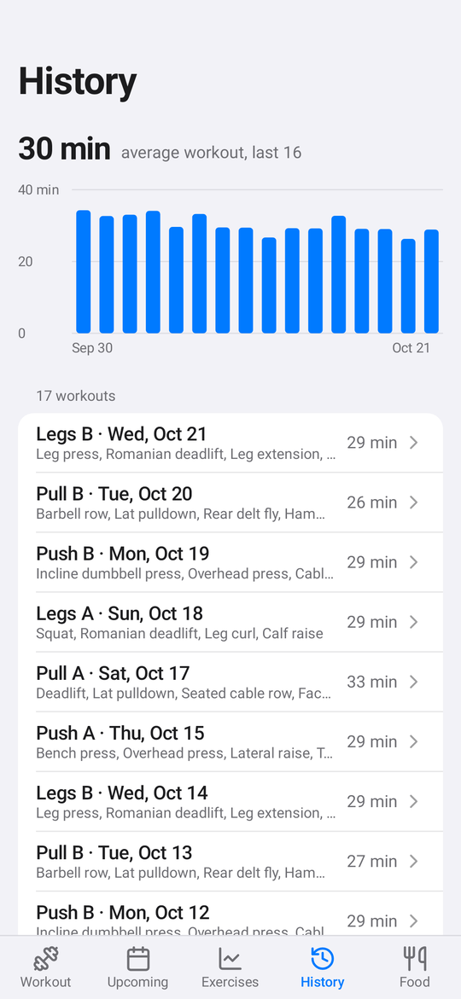
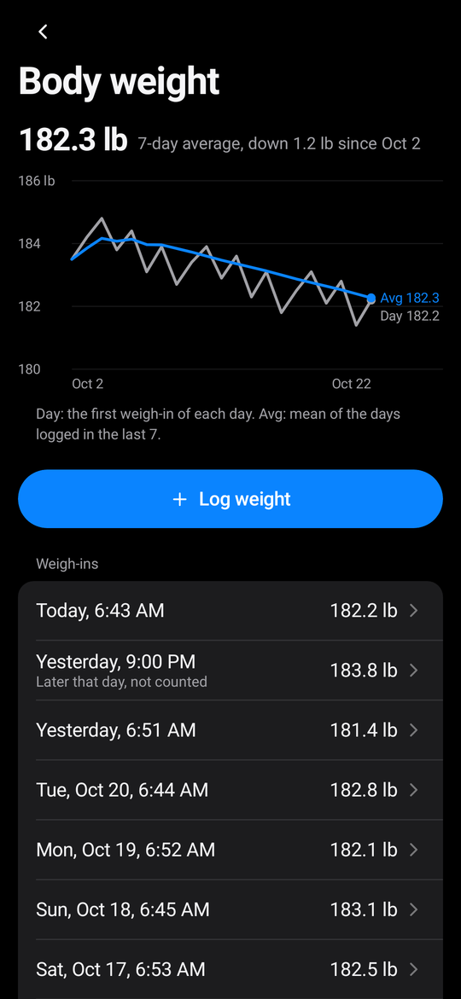
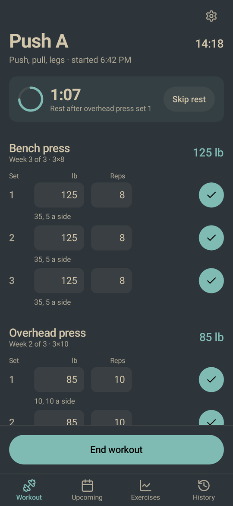
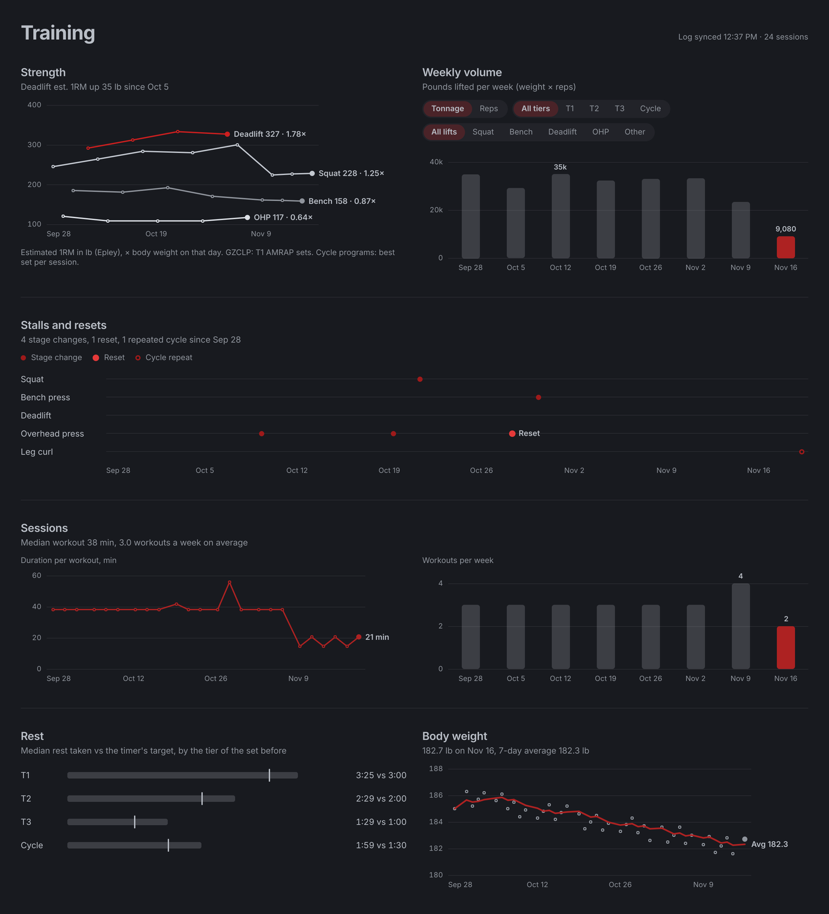

# GZCLP tracker

An Android workout tracker with six programs: GZCLP (4 days, A1, B1, A2, B2), Bro split (5 days), Push, pull, legs (6 days), Upper, lower (4 days), Full body (3 days), and Chest, back, legs (3 days). GZCLP runs its T1, T2, and T3 progression with stage changes and resets. Every other program runs a 3-week cycle per exercise: 3×12, then 3×10 one step heavier, then 3×8 two steps heavier, then back to 3×12 at 5 lb over the last cycle's base if every heavy set reached 8.

The app logs a weight and reps for every set, shows the next eight workouts and a month of past ones, charts each exercise's top set and estimated 1RM, tracks body weight (each morning's first weigh-in, a 7-day average, and a daily reminder set in Settings) so each lift can also chart its estimated 1RM as a multiple of body weight, and runs a rest timer that vibrates with the screen off. All data stays on the phone, except what you choose to write to Android Health Connect. The app mirrors its log to a folder you share with Syncthing. `docs/log-format.md` describes that log (version 2) for the desktop analysis app.

## Screenshots

Rendered by the Roborazzi screenshot test (`ScreenShots.kt`) from its demo data.

| Next workout | Rest timer | Exercise |
| :---: | :---: | :---: |
|  |  |  |
| **History** | **Body weight** | **Laptop theme (Everforest)** |
|  |  |  |

The desktop analysis app (`desktop/`) reads the synced log:



## Build

Requirements: JDK 21 and an Android SDK with `platforms;android-35` and `build-tools;35.0.0`. The Gradle wrapper downloads Gradle itself.

```bash
eval "$(mise env -s bash)"            # sets ANDROID_HOME on this machine
echo "sdk.dir=$ANDROID_HOME" > local.properties
./gradlew test                         # progression engine and log tests
./gradlew assembleDebug                # app/build/outputs/apk/debug/app-debug.apk
```

Screenshots of every screen in every theme:

```bash
./gradlew recordRoborazziDebug -PgzclpShots=/path/to/shots
```

## Install

Enable USB debugging on the phone, connect it, then:

```bash
adb install -r app/build/outputs/apk/debug/app-debug.apk
adb shell am start -n dev.gzclp.tracker/.MainActivity
```

## First run

1. Enter a 5-rep max for each main lift and pick a program. GZCLP starts T1 at 85% and T2 at 65%; the cycle programs start week 1 at 65%. All rounded to 5 lb. Other exercises ask for a starting weight the first time they come up.
2. In Settings, choose the sync folder (for example `Documents/GZCLP`) and share it with Syncthing. The app writes `gzclp-log.jsonl` there. If the laptop also syncs `omarchy-theme.toml` into that folder, the Laptop theme in Settings follows it; the app reads that file and never writes it.
3. Allow notifications when asked, so the rest timer can alert you with the screen off and the 7:00 AM weigh-in reminder can reach you.

After a reinstall, tap Restore log on the first screen and pick the same folder.

To send workouts and weigh-ins to Health Connect, turn on Health Connect in Settings and allow access. From then on, each finished workout becomes a strength-training session (one segment per set with its reps, every set's weight in the notes) and each weigh-in becomes a weight record; editing or deleting a weigh-in updates Health Connect too. The app only writes and never reads. Workouts and weigh-ins from before you turned it on are not sent. Without Health Connect, or with access denied, everything else works the same.

In Settings you can switch programs (history and each exercise's progress carry over), add or remove exercises per workout, and change the cycle steps (5 lb upper body, 10 lb lower body, 5 lb per new cycle by default), and set your bar and plates (a 45 lb bar; pairs of 45, 35, 25, 10, 5, and 2.5 lb plates by default). Barbell lifts round each target to the nearest weight those plates make, and every set shows the plates for one side. Progression still counts from the program's own weight.

Version 2 reads only version 2 logs. On first launch it sets an older local log aside as `gzclp-log.jsonl.old`; uninstall first for a clean start.

## Layout

- `engine/` holds the program table, the GZCLP progression, and the 3-week cycle, as pure Kotlin.
- `log/` holds the event log, its JSON codec, the state fold, the commands that turn taps into events, and the per-exercise stats.
- `sync/` mirrors the log into the shared folder.
- `rest/` holds the rest alarm and its notifications.
- `remind/` holds the daily weigh-in reminder.
- `health/` turns finished workouts and weigh-ins into Health Connect records, and holds the privacy note Health Connect shows.
- `ui/` holds the Compose screens and the four color themes.
