# Design review, 2026-11-26

Not for merge. This branch holds a review of the app's visual design and of how it feels to use, with a screen recording for each problem. It changes no app code.

Method: design review only (detector not applicable, native platform).

## What was reviewed

- Build: `origin/main` at `3dcaea0`, the debug variant (`dev.gzclp.tracker.debug`) on a Galaxy S21 (1080 x 2400, 120 Hz, system font size 1.15, dark mode).
- Data: a synthetic month written by the test suite's `Demo` object, shifted five days into the past. No real log appears in any clip.
- Stills: 697 Roborazzi renders from `./gradlew recordRoborazziDebug` (Jade, Tokyo Night, Dark, Light, Liquid Glass, and the 27 Omarchy themes), read screen by screen in Tokyo Night, then Liquid Glass and Light.
- Clips: 27 recordings made with `adb shell screenrecord`, trimmed to 2 to 8 seconds. Each has a GIF (at most 480 px wide, at most 3 MB) and a small MP4 in `clips/`. The status bar is cropped out.
- Source: `app/src/main/java/dev/gzclp/tracker/ui/` and `MainActivity.kt`, cited as `file:line`.

Gestures were injected with `adb shell input`, so they are straight lines at constant speed. Each finding says whether it was filmed on the phone or read from source. Nothing here claims how a real finger feels beyond what the recordings show.

## Skills applied

| Skill | How it was used |
|---|---|
| apple-ui | The main rulebook: the 16 rules, `screens.md`, `controls.md`, `motion.md`, and the defect hunt in `finish.md`. Rule numbers below are its numbers. |
| liquid-glass | Its 11 rules, checked on the Liquid Glass theme in renders and on the phone. |
| impeccable | `critique` (Nielsen scores, cognitive load, personas) and the native `audit` (five dimensions). Its Android reference says Material 3 governs. The project brief pins Apple conventions instead, so "not Material" is not a finding here. The guarantees the OS still owes are scored: system Back, insets, font scale, TalkBack labels, 48 dp targets, Remove animations. |
| taste-skill | It builds marketing websites, and its gate was not run. Only the checks that transfer were applied: one system, no fact twice, one action per screen, tap size, copy. |
| unslop | Copy rules 3 to 33 and the layout rules, on every visible string. |

## Scores

Nielsen heuristics (impeccable critique), 0 to 4 each:

| # | Heuristic | Score | Main issue |
|---|---|---|---|
| 1 | Visibility of system status | 3 | Today is not marked on a day that has training |
| 2 | Match with the real world | 3 | Unlabeled times beside sets, "@ 8", "After last set" |
| 3 | User control and freedom | 3 | Undo exists for weigh-ins and water; no predictive Back |
| 4 | Consistency and standards | 2 | Three Delete styles, two slider behaviors, two week starts |
| 5 | Error prevention | 2 | A slider release saves; a tap on the cup logs a partial amount |
| 6 | Recognition rather than recall | 2 | Hidden cup gesture, no Save button, an eye icon for "about" |
| 7 | Flexibility and efficiency | 3 | Quick start, swipe to delete, held steppers repeat |
| 8 | Aesthetic and minimalist design | 3 | Accent on four things at once; facts shown twice |
| 9 | Error recovery | 3 | Messages are specific where they exist |
| 10 | Help and documentation | 2 | No hint for any gesture |
| | Total | 26/40 | Acceptable, at the top of the band |

Native audit (impeccable audit), 0 to 4 each:

| Dimension | Score | Main issue |
|---|---|---|
| Accessibility | 3 | Labels truncate at font size 1.15; Remove animations only half honored; targets are 44 dp where Android asks for 48 |
| Performance | 3 | Not profiled. A tab switch lands within one frame. Page blur and glass panes add GPU work (read from source) |
| Appearance and theming | 4 | Every color is a token and a test holds each theme to 4.5:1 |
| Platform conformance | 2 | Apple conventions by design; predictive Back is not enabled |
| Adaptivity | 2 | Phone portrait only was checked (landscape and tablets unverified) |
| Total | 14/20 | Good, at the bottom of the band |

Cognitive load: 2 of 8 checks fail (minimal choices on the Lifting settings page and the setup program list, and progressive disclosure on the cardio edit sheet). That is moderate.

## What works

- One press surface, one type ladder, one spacing scale, one radius scale. Weights are 400, 600 and 700 except in two places listed under Copy.
- Settings reads like iOS Settings: a short root list, grouped rows, hairlines on the text column, right-aligned values.
- The set table: the current set sits on a tinted pill that springs to the next row, the rest timer lives in the fixed bar so logging never moves a row under the thumb, and a logged set gives a haptic.
- Swipe to delete tracks the finger, resists past closed, and hands its velocity to the spring.
- Exercise and body weight pages lead with the number and one sentence, then the chart.
- Tab switching is already fast. In `clips/26-tabs-baseline.mp4` the new tab's content is drawn in the same 120 Hz frame as the bar's first change after the tap, and the pill settles in about 60 to 75 ms. The tap was injected, so touch-down to first frame was not measured.

## Findings, ranked by user impact

Each finding has its clip, the rule it breaks, a fix, and a size: quick (under a day, local) or large (touches several screens or needs a design decision).

### 1. Liquid Glass covers the content and stacks glass on glass (large)

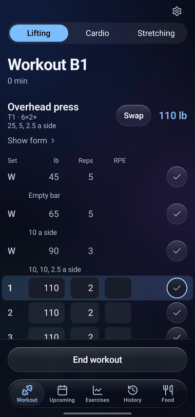
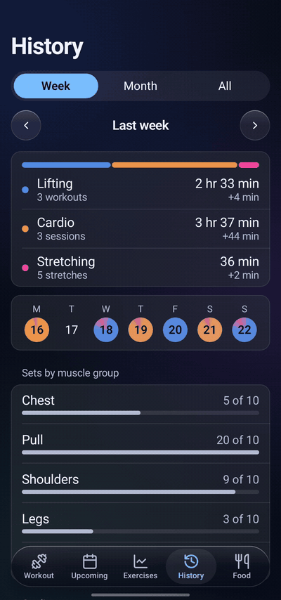

- Screen: every screen in the Liquid Glass theme. Filmed on the phone.
- Wrong: cards are translucent panes with a lit edge (`Theme.kt:39`), and every filled control gets a sheen and a rim (`Components.kt:197`), so glass is on the content and on dozens of controls. In a workout the tab bar capsule sits on the bottom glass pane and the Skip rest pill sits on it too (`Screens.kt:133`, `Components.kt:687`). The pane ends in a hard hairline where rows are cut off. In History, rows show through and around the floating capsule.
- Rule: liquid-glass 1 (glass is the navigation layer, never the content), 2 (one or two glass layers per screen), 3 (no glass on glass), 7 (a scroll edge, not a divider), 11 (cost grows with the number of glass surfaces).
- Fix: keep glass for the tab bar, sheets, and the undo bar only. Make cards and controls solid in this theme. Merge the bottom bar and the tab bar into one glass surface while a bottom bar is showing, and fade content at its top edge instead of drawing a hairline.
- Clips: [MP4 1](clips/01-glass-on-glass.mp4), [MP4 2](clips/02-glass-scroll.mp4)

### 2. Letting go of the weigh-in slider saves, and the sheet has no Save button (quick)

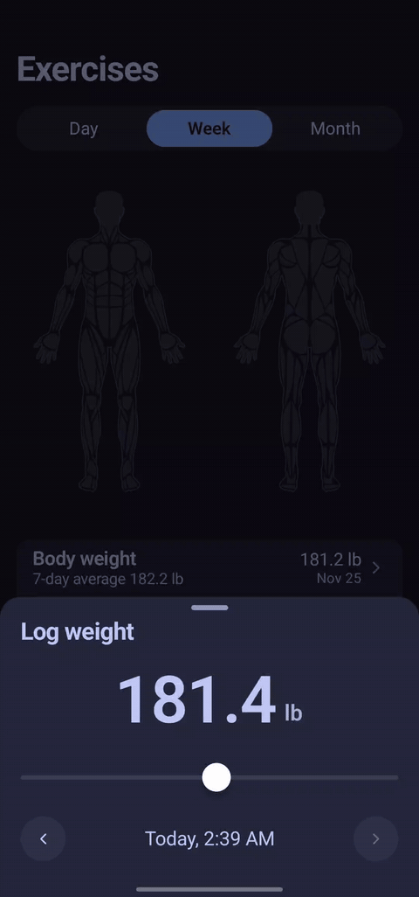

- Screen: Exercises, Log weight. Filmed on the phone.
- Wrong: the sheet shows a number, a slider and a date. Lifting the finger from the slider saves the weigh-in and closes the sheet (`Sheets.kt:225`, `Water.kt:374`). There is no button, so nothing on screen says how to save, and saving the weight shown without changing it needs a tap on the number and then Done on the keyboard. A brush of the slider records a weigh-in.
- Rule: apple-ui "one primary button per view"; Nielsen 5 and 6; `motion.md` 16 (agency: confirm meaningful actions).
- Fix: add a "Save 182.3 lb" primary pill under the date row, as the starting weight sheet has, and let the slider only set the value. Keep the undo bar.
- Clip: [MP4](clips/03-weigh-in-saves-on-release.mp4)

### 3. A tap on the water cup logs an odd amount, and nothing says the cup is a control (quick)

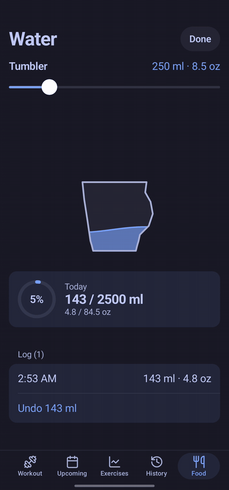

- Screen: Food, Water intake. Filmed on the phone.
- Wrong: the cup is an outline with no label. A tap in the middle of the 250 ml cup logged 143 ml, because the amount is the height of the touch (`Water.kt:464`, `Water.kt:487`). Dragging up to fill it is the intended gesture and nothing hints at it. Every amount is also shown twice, in ml and in oz, and the day's total is stated three ways (ring, fraction, "Goal reached").
- Rule: apple-ui 15 (an icon stands alone only when anyone names it on sight) and 16 (each fact once); Nielsen 5 and 6.
- Fix: a tap logs the whole cup. Keep the drag for a partial amount. Put a "Log 250 ml" pill under the cup. Show one unit, chosen in Goals.
- Clip: [MP4](clips/05-water-cup.mp4)

### 4. Open session shows three Add exercise buttons, and an empty session still asks whether to count it (quick)

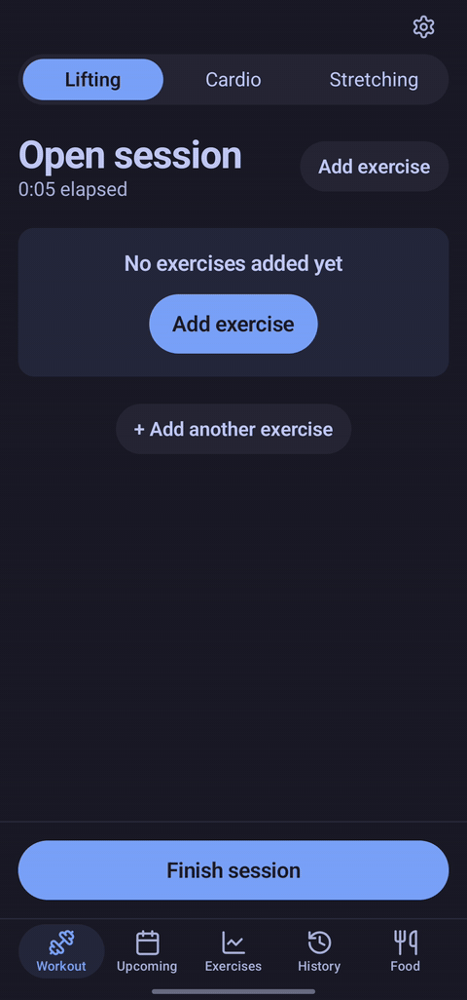
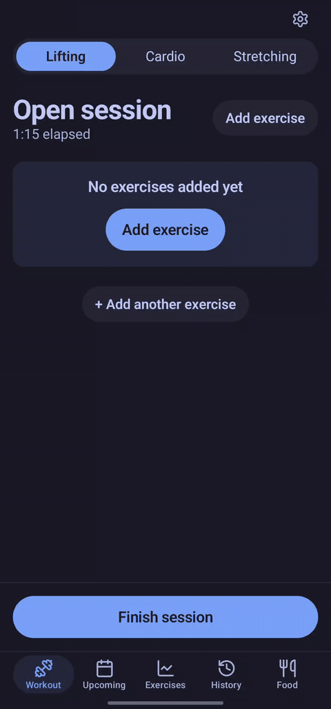

- Screen: Workout, Open session, Start blank. Filmed on the phone (the first clip plays at 2.2 times speed).
- Wrong: "Add exercise" appears in the header, in the empty card, and as "+ Add another exercise" before any exercise exists (`OpenSession.kt:483`, `:494`, `:519`). All three open the same sheet. Two accent pills (Add exercise, Finish session) compete. Finishing a session with nothing in it asks "Count toward your program?" with "Yes, count toward program" and "No, off-plan session" (`OpenSession.kt:350`, `:358`). The plus signs are typed characters, not icons.
- Rule: apple-ui 1 (no duplicate controls), 15 (never a text character as an icon), UI copy (never Yes or No on a button); taste-skill "one action twice a screen at most".
- Fix: one Add exercise pill in the empty card until the first exercise exists, then one "Add exercise" row with the plus icon at the end of the list. Finish session stays neutral until a set is logged. An empty session ends without the question. Label the choices "Count it" and "Keep it off plan".
- Clips: [MP4 1](clips/06-open-session-add.mp4), [MP4 2](clips/07-empty-session-count.mp4)

### 5. Cardio sliders jump when grabbed by the thumb (quick)

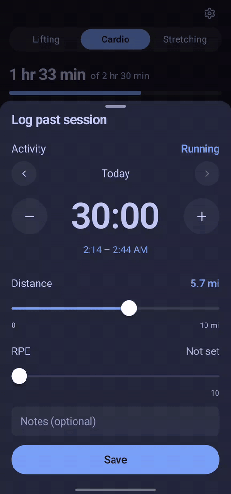

- Screen: Cardio, Log past session (also Stop and Edit). Filmed on the phone.
- Wrong: touching the thumb's right edge moved Distance from 5.7 to 6.1 mi before any drag, and touching its left edge moved it to 5.3. `Slider` centers the thumb on the touch (`Components.kt:515`). The weigh-in and cup size sliders use a second component, `StepSlider`, which keeps the grab offset (`Water.kt:366`), so the app has two slider behaviors.
- Rule: `controls.md` sliders ("a drag that starts on the thumb keeps the grab offset, so the thumb never jumps"); apple-ui composition 4 (one component family).
- Fix: delete `Slider` and use `StepSlider` everywhere. The RPE slider also needs a label at its left end, as Distance has.
- Clip: [MP4](clips/04-slider-jump.mp4)

### 6. Labels are cut off at the phone's own font size (quick)

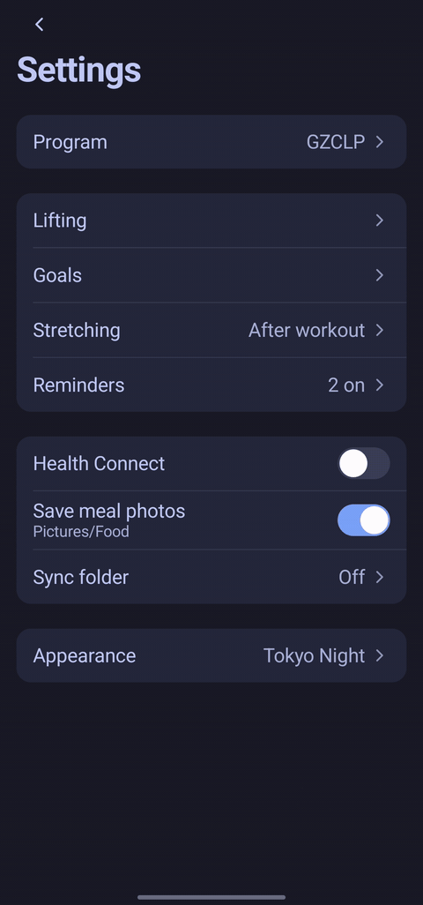

- Screen: Settings, Goals. Filmed on the phone at its normal font size, 1.15.
- Wrong: "Cardio each week" reads "Cardio each w…". The label has one line and shares the row with two 44 dp buttons and a 120 dp value (`Settings.kt:146`, `:282`). In a workout the rest label wraps and leaves a lone "1" on its own line (visible in `clips/01-glass-on-glass.gif`). On Body weight the sentence beside the big number wraps so that the date reads as part of the number ("182.1 lb Oct 27", `clips/23-body-weight.gif`).
- Rule: apple-ui 13 (nothing clipped); impeccable audit, text scaling; `finish.md` extremes.
- Fix: let the label wrap to two lines, or move the stepper under the label when it does not fit. Run the existing `-PgzclpFontScale=1.3` renders in CI.
- Clip: [MP4](clips/08-label-truncated.mp4)

### 7. The history calendar paints every day, hides today, and disagrees with itself about the week (large)

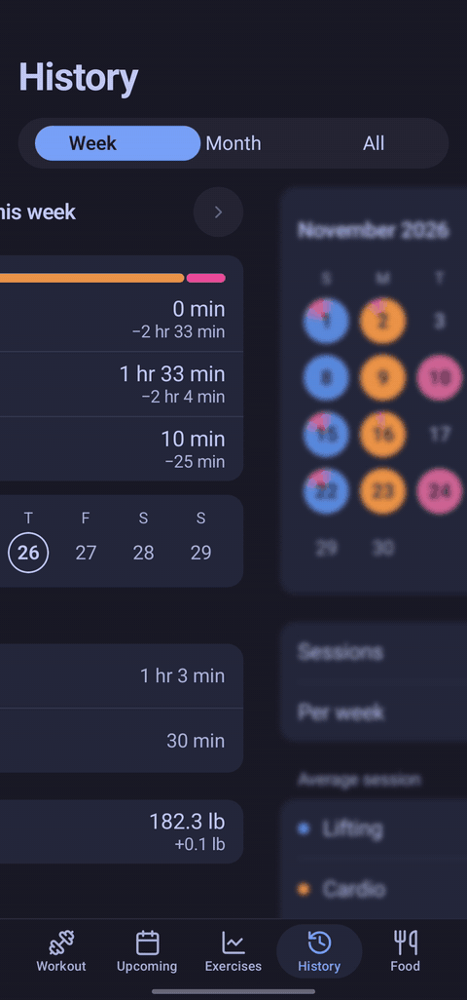

- Screen: History, Week and Month. Filmed on the phone.
- Wrong: every day with training is a saturated 40 dp disc, blended from blue, orange and pink by how the day's time split (`DayMarker.kt:97`). In the demo month 26 of 30 days are filled, so nothing stands out and the blend cannot be read at that size. Today gets a ring only when it is empty; once today has a workout it looks like any other day (`Upcoming.kt:123` to `:135`, `Week.kt:105`). The Week strip starts on Monday and the Month grid on Sunday (`Upcoming.kt:108`). Weekday headers are single letters. Week uses filled circle arrows and Month uses bare accent arrows (`Week.kt:53`, `Upcoming.kt:103`).
- Rule: apple-ui 2 (category colors as small marks only), 14 (the current item looks different), 16 (one format); `screens.md` grids of cells (a 4 px dot under the numeral, today as the accent circle, two letters at least in headers).
- Fix: plain numerals, one 4 px dot per kind under each, today as an accent-filled circle, both views starting on the same day, one arrow style.
- Clip: [MP4](clips/09-calendar.mp4)

### 8. Delete looks three different ways (quick)

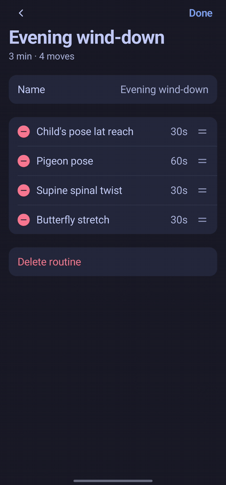
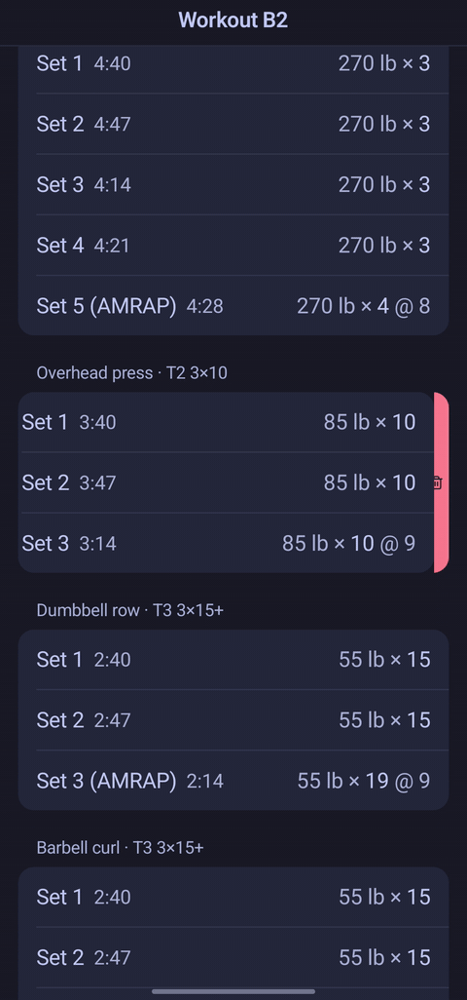

- Screen: every confirm sheet. Filmed on the phone.
- Wrong: deleting from History is a red pill (`Sheets.kt:305`). Deleting a routine, a split, a day or a meal is an accent pill, the same look as Save (`Sheets.kt:247`, `:366`, `:409`). Deleting a weigh-in, a cardio session or a meal from its own sheet is a neutral pill (`Sheets.kt:243`, `Cardio.kt:382`, `Food.kt:331`). The open session sheets are a third family: centered title, stacked buttons, a small Cancel.
- Rule: apple-ui composition 4; Nielsen 4 and 5; UI copy (destructive actions name what they remove).
- Fix: pass `destructive = true` at every delete confirm, make the neutral Delete buttons red text, and build the open session sheets from `SheetTitle` and `CancelOr`.
- Clips: [MP4 1](clips/10-delete-accent.mp4), [MP4 2](clips/11-delete-red.mp4)

### 9. Thumbs bounce on a plain tap, and Remove animations is only half honored (quick, then large)

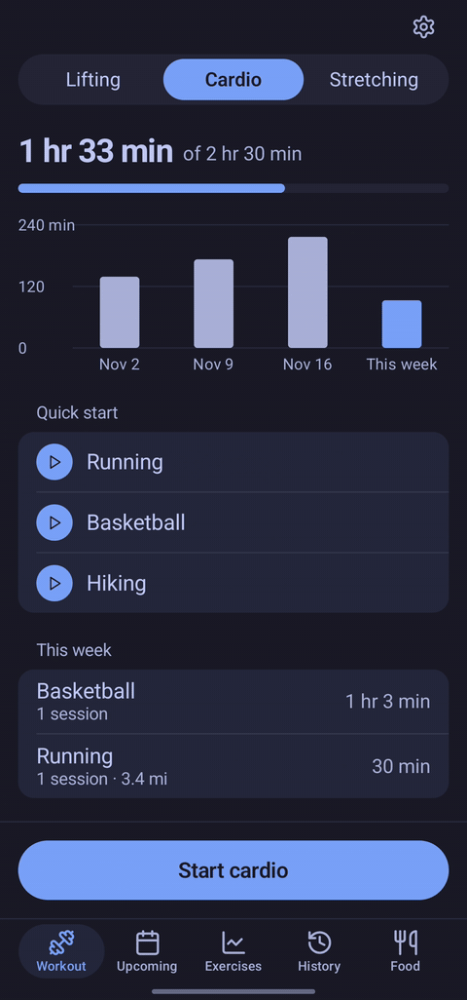
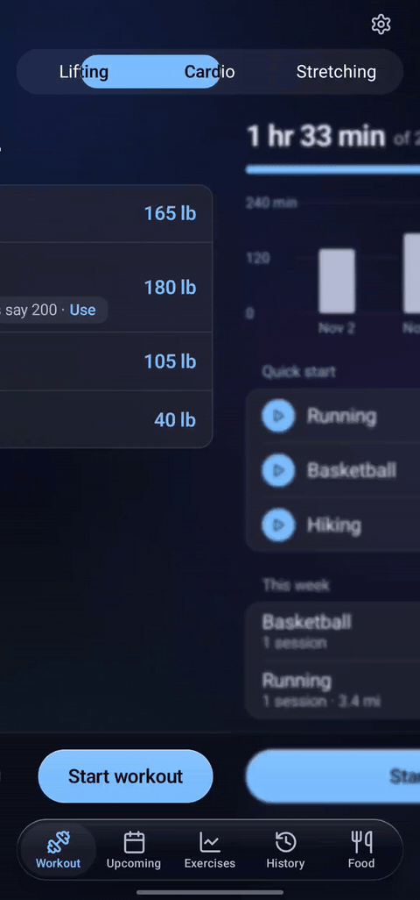

- Screen: the Lifting, Cardio, Stretching switch, every segmented control, the tab bar. Filmed on the phone; the first clip plays at quarter speed and the second at 0.6 times speed.
- Wrong: after a tap the thumb stretches wide, widens past the end of its track, and squashes back. Its spring is under-damped at 0.7, the squash at 0.4, the lift at 0.45 and the swell at 0.55 (`Thumb.kt:137` to `:140`, `Components.kt:403`). With the system's Remove animations on, sheets and pushes cut in one frame, but the switch and its pages kept moving for 175 to 200 ms (21 to 23 frames, measured from the second clip), because those springs are stepped by hand each frame (`Pages.kt:66`, `Thumb.kt:125`) and never read the setting.
- Rule: apple-ui 8 ("no bounce"); `motion.md` 4 (bounce only when the gesture carried momentum) and 14 (reduced motion becomes a cross-fade).
- Fix: damping 1.0 for a tap; keep a little bounce only for a drag release. Read `Settings.Global.ANIMATOR_DURATION_SCALE` once and snap both frame loops and the page blur when it is 0.
- Clips: [MP4 1](clips/12-thumb-bounce.mp4), [MP4 2](clips/13-animations-off.mp4)

### 10. Sheets stop dead when pulled up and ignore how fast they were let go (quick)

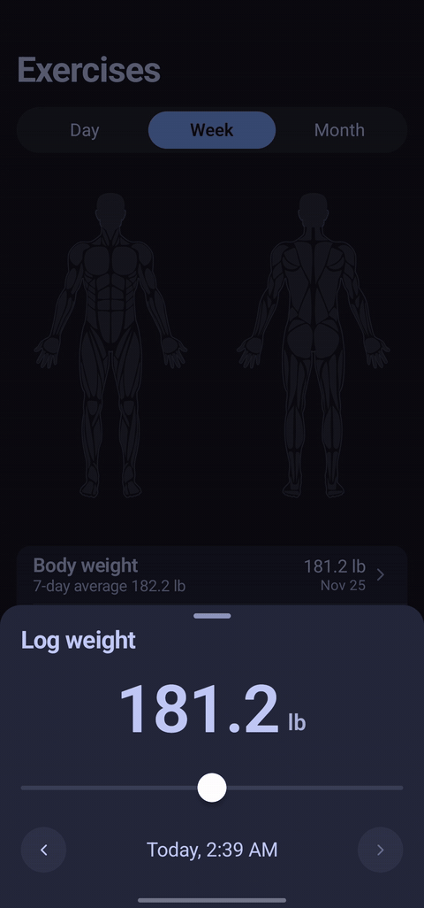
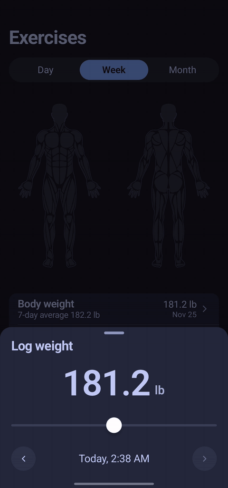

- Screen: every bottom sheet. Filmed on the phone.
- Wrong: pulled down a little and released, the sheet returns on a fixed 200 ms curve whatever the finger's speed. Pulled up, it does not move at all. A slow 220 px pull dismissed the weigh-in sheet (second clip), because the threshold is a quarter of the sheet's height and only a 1500 px/s flick counts as intent (`Components.kt:587` to `:591`). The sheet cannot be caught while it slides in (that part is read from source, `Components.kt:573` to `:577`).
- Rule: `motion.md` 3 (interruptible), 5 (velocity handoff), 6 (project the momentum), 9 (rubber-band at a boundary).
- Fix: drive the sheet with one `Animatable`, as `SwipeToDelete` does: resist upward pulls at a third, settle with the release velocity, and choose open or closed from the projected end point.
- Clips: [MP4 1](clips/16-sheet-drag.mp4), [MP4 2](clips/16b-sheet-slow-pull-dismisses.mp4)

### 11. Cardio spends the accent on four things and lists this week's sessions twice (quick)

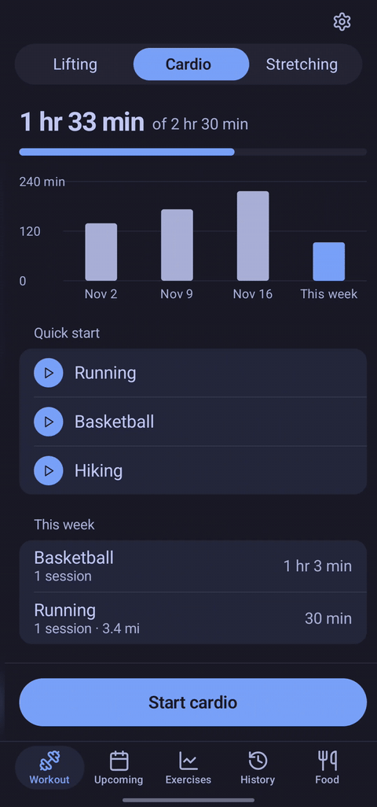

- Screen: Workout, Cardio. Filmed on the phone.
- Wrong: the selected segment, the progress bar, three play discs and Start cardio are all full accent (`Components.kt:351`, `Cardio.kt:168`), so the switch is as loud as the screen's action. "This week" appears as a bar label and a group header. Each of this week's sessions is listed under This week and again under Sessions, once as "3.4 mi" and once as "3.37 mi" (`Cardio.kt:179`, `:181`).
- Rule: apple-ui 2 (one accent), composition 1 (one focal axis), 16 (each fact once and every number agrees); `screens.md` segmented control (accent at about 35 percent over the track).
- Fix: tint the selected segment instead of filling it, make the play discs neutral, drop the This week group, and print distance to one precision.
- Clip: [MP4](clips/17-cardio-page.mp4)

### 12. A finished workout shows numbers without saying what they are (quick)

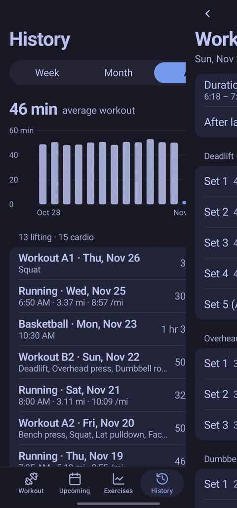

- Screen: History, a workout. Filmed on the phone.
- Wrong: each row reads "Set 2 4:47 … 270 lb × 3". The 4:47 is the rest before that set (`History.kt:190`), and nothing says so. "After last set 2 min" and "@ 8" for RPE are also unexplained. Four rows repeating "270 lb × 3" fill a screen with one fact.
- Rule: unslop web-ui ("every number has its unit"); apple-ui banned patterns (a value repeated down a column); Nielsen 2.
- Fix: a small "Rest" header over that column, "RPE 8" in place of "@ 8", "Left running" in place of "After last set", and sets at one weight collapsed to "4 × 3 at 270 lb" with a tap to expand.
- Clip: [MP4](clips/18-session-times.mp4)

### 13. The stretch player and its finish screen are a second design (quick)

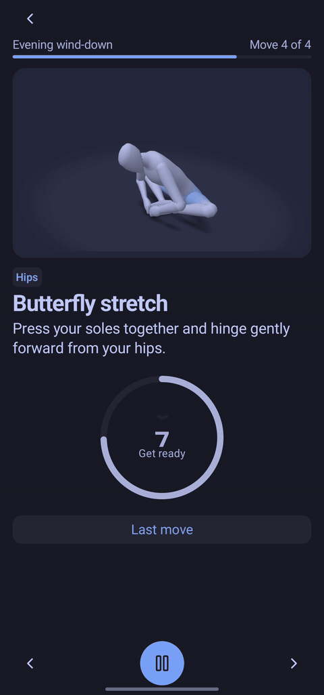

- Screen: Stretching, the player. Filmed on the phone.
- Wrong: "Routine Complete!" and "Log & Finish" are title case with an exclamation mark and an ampersand (`Stretch.kt:631`, `:652`). "UP NEXT" is a bold all-caps accent eyebrow (`Stretch.kt:502`). Corners are 16, 12 and 6 dp from outside the radius scale (`Stretch.kt:443`, `:495`, `:506`). Previous and next use the same chevrons as Back. After skipping every move the screen reports 4 moves done in 0:23 and offers to log it.
- Rule: apple-ui 7 (sentence case), 5 (radius scale), banned patterns (eyebrows, KPI tiles); unslop 17; apple-ui 16 (a counter matches what it counts).
- Fix: "Routine done", "Log routine", "Next" as a plain footnote label, radii from `Radius`, skip glyphs for previous and next, and count only moves that were held.
- Clip: [MP4](clips/19-stretch-complete.mp4)

### 14. The stretching list names the chosen routine twice and hides your own routines (quick)

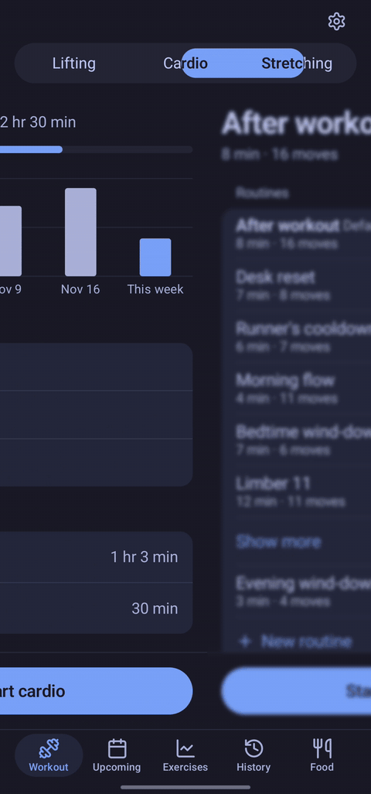

- Screen: Workout, Stretching. Filmed on the phone.
- Wrong: the title and its "8 min · 16 moves" repeat in the first row directly below. An eye icon opens About on built-in routines and an info icon opens the page on your own, in the same slot. "Show more" sits in the middle of the list, so your own routines and New routine come after it. Tapping a row selects it, which is not what a row with a trailing icon suggests.
- Rule: apple-ui 16 (each fact once), 15 (one icon family, understood on sight); Nielsen 4.
- Fix: your routines first, then built-in ones, with Show more as the last row. One chevron per row that opens the routine's page, and the check mark alone for the selection.
- Clip: [MP4](clips/20-stretch-list.mp4)

### 15. The main action sits in a different place on each tab (large)

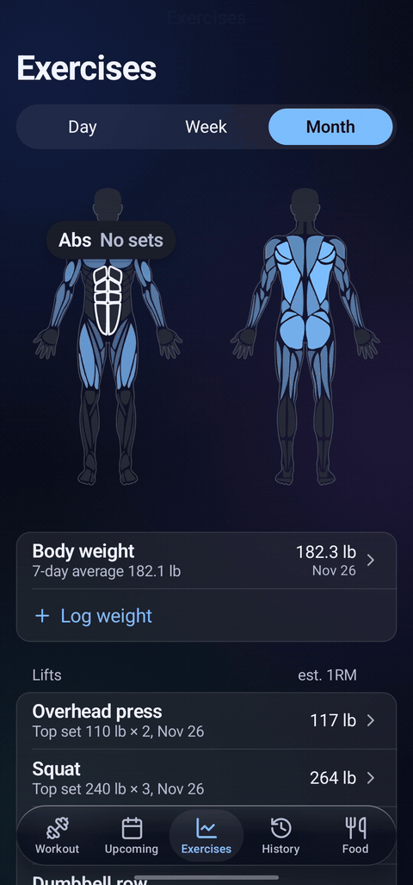

- Screen: all tabs. Filmed on the phone and seen in the renders.
- Wrong: Workout, Cardio and Stretching pin the action in a bottom bar. Food puts Take photo and Upload at the top (`Food.kt:99`). Body weight puts Log weight in the middle of the page between the chart and the list. Exercises shows the same action as a text row. Next workout's bottom bar has a 36 dp gap between its pills where every other bar has 12 dp (`Screens.kt:276`).
- Rule: apple-ui 9 (controls in the same place on every screen); impeccable persona "Casey" (primary actions in the thumb zone).
- Fix: one rule, the screen's primary action lives in the bottom bar. Remove the extra spacer.
- Clip: [MP4](clips/23-body-weight.mp4)

### 16. Day, Week, Month on Exercises looks like a page filter but only changes the body map (quick)

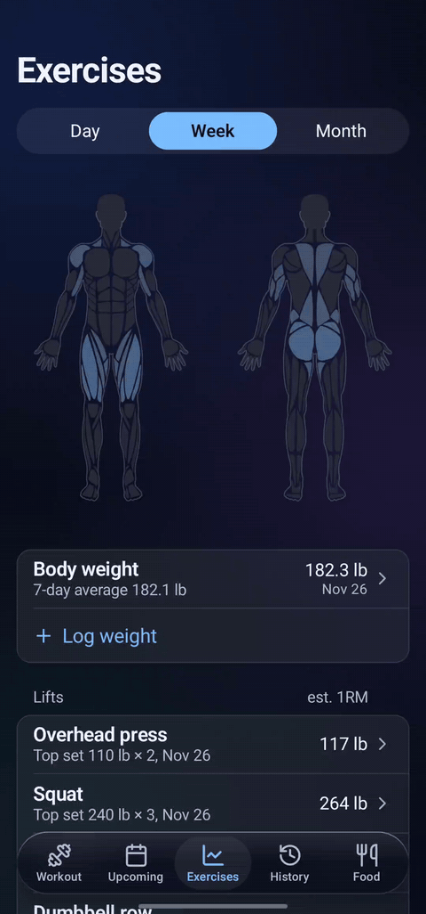

- Screen: Exercises. Filmed on the phone.
- Wrong: the segmented control sits directly under the page title (`Exercises.kt:75`). It changes the muscle map and nothing else. Body weight and the lifts list stay the same. The map has no scale, so a shade means nothing until a muscle is tapped, and the tapped label covers the figure's head.
- Rule: apple-ui rule 16 and `screens.md` ("controls sit with what they change"), 12 (every mark shows data you can read).
- Fix: move the control onto the map's own row with a one-line scale ("0 to 20 sets"), and place the label beside the muscle.
- Clip: [MP4](clips/22-exercises-switch.mp4)

### 17. Pages blur while they are swiped (quick)

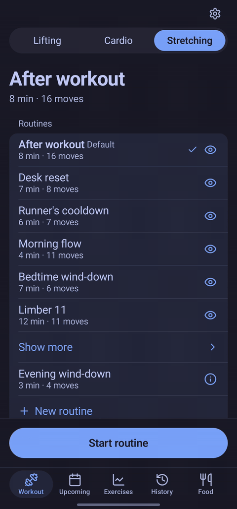

- Screen: Workout and History pages. Filmed on the phone at half speed.
- Wrong: past the halfway point the leaving page blurs up to 24 dp (`Pages.kt:130`, `:139`). The blur radius changes every frame of the swipe, on a full page layer, and in Liquid Glass the tab bar blurs that same content again (the second part is read from source). The page cannot be read for the second half of a slow swipe.
- Rule: liquid-glass 9 (never animate blur radius across many elements); `motion.md` 11 (frame-level smoothness).
- Fix: slide the pages with no blur, or cross-fade the last quarter. This also helps the tab speed work.
- Clip: [MP4](clips/15-page-blur.mp4)

### 18. A pressed list row shrinks (quick)

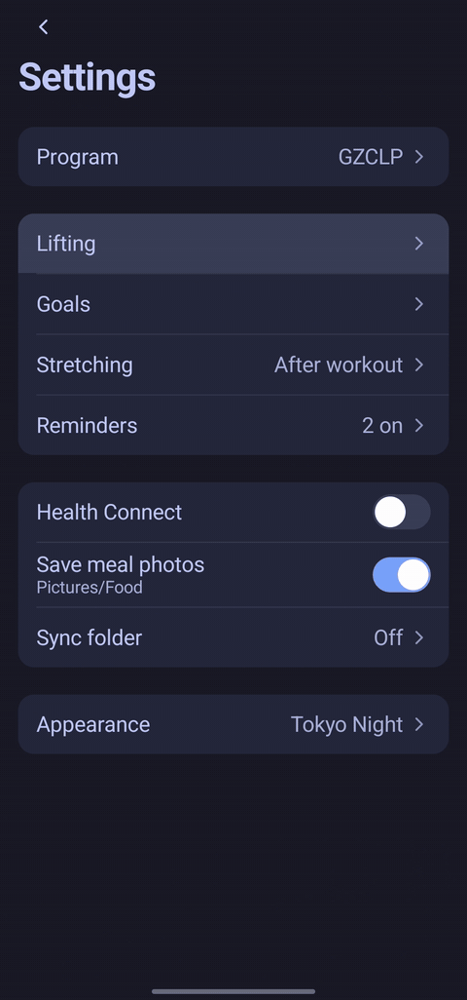

- Screen: Settings and every grouped list. Filmed on the phone at 0.3 times speed.
- Wrong: every tappable thing is one `Pressable`, which scales to 0.97 (`Components.kt:186`), and full-width rows use it too (`Components.kt:310`). A pressed row pulls in from the card's edges, so its highlight stops short of the card and its text jumps about 12 px toward the center. Small 44 dp buttons scale by the same 3 percent, which is about one pixel and cannot be seen.
- Rule: `controls.md` ("full-width rows and cards not at all, they take the pressed fill only"; buttons under 40 px press to 0.92).
- Fix: a `scale` parameter on `Pressable`: 1.0 for rows, 0.97 for pills, 0.92 for icon buttons and steppers.
- Clip: [MP4](clips/14-row-press.mp4)

### 19. Warm-up plate lines float halfway between two rows (quick)

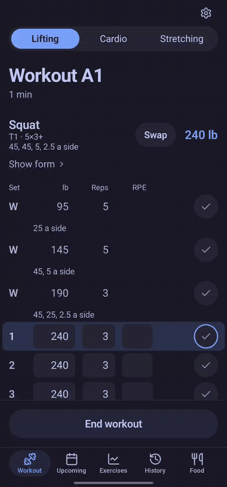

- Screen: Workout, warm-up sets. Filmed on the phone and measured on a render.
- Wrong: "25 a side" sits 70 px below its own row's numbers and 70 px above the next row's, so it reads as a caption for either. The row is 44 dp tall for its check button and the caption follows it in a column spaced by 8 dp (`Screens.kt:443`, `:609`).
- Rule: apple-ui 11 (space between groups is clearly larger than inside them), 13 (a mark is nearer its own label than a neighbor's).
- Fix: put the plate line inside the row under the weight, and widen the gap between warm-up rows.
- Clip: [MP4](clips/21-warmup-captions.mp4)

### 20. The History chart stops three quarters of the way across (quick)

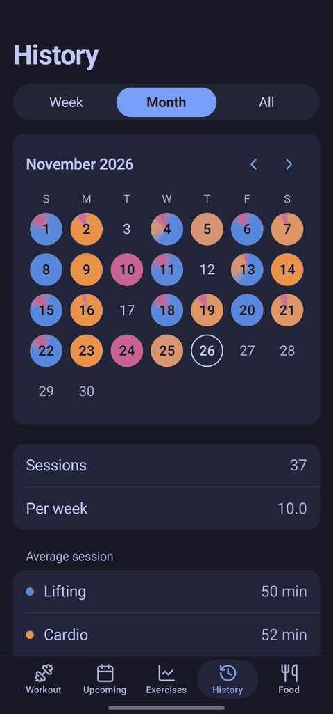

- Screen: History, All. Filmed on the phone.
- Wrong: the bars end at about 75 percent of the plot's width and the gridlines run on over nothing (`History.kt:291`). Thirteen bars of nearly equal height say little that "46 min average workout" does not.
- Rule: `screens.md` charts ("the x scale is fitted to the data, never a band of empty plot after the last point").
- Fix: fit the bars to the plot width, or replace the chart with one line of minimum, average and maximum.
- Clip: [MP4](clips/24-history-chart.mp4)

### 21. Upcoming has a calendar icon and no dates (large)

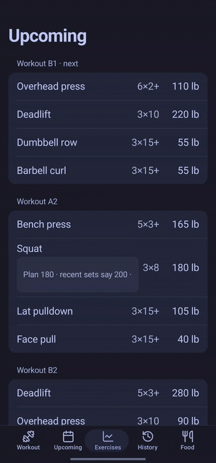

- Screen: Upcoming. Filmed on the phone.
- Wrong: the tab is a long scroll of the next workouts as identical tables. None says when it falls. The weight suggestion "Plan 180 · recent sets say 200 · Use" sits inside a row as a chip and reads as shorthand.
- Rule: apple-ui composition 2 (a data view leads with the answer); Nielsen 2; `motion.md` 16 (specific labels).
- Fix: show the next workout large with its likely day, the following ones as one line each ("Workout B1, squat 250 lb"), and write the suggestion as a sentence with a "Use 200 lb" button.
- Clip: [MP4](clips/25-upcoming.mp4)

### 22. Predictive Back is off and touch targets are 44 dp (large, quick)

No clip: `adb` cannot inject the system Back swipe, and target size does not show in a recording. Read from source.

- Wrong: the manifest does not set `android:enableOnBackInvokedCallback`, so the system cannot preview where Back goes, and pushed screens pop on a fixed 200 ms slide (`MainActivity.kt:369` to `:375`). Icon buttons, steppers and set checks are 44 dp (`Components.kt:262`, `:543`), the iOS size. Android's guidance is 48 dp.
- Rule: impeccable `android.md` (system Back, 48 dp targets), kept from Material because they are OS guarantees.
- Fix: opt in, and drive the pop from `PredictiveBackHandler` progress so a pushed screen follows the finger. Raise hit areas to 48 dp without changing the drawn size.

### 23. Copy (quick)

Seen in the clips above and in the renders.

- Title case: "Espresso Cup", "Tall Glass" (`Water.kt:222`), "Upper Back" (`BodyArea.kt:13`), "Routine Complete!", "Log & Finish".
- Instructions as copy: "Top estimates (tap to confirm)" in the meal sheet.
- A typed ellipsis and typed plus signs: "Search exercises…", "+ Add another exercise", "+ Add set".
- Three unit styles for one quantity: "30s" in routine rows, "Hold: 30 seconds" in the move preview, "45 sec" in the hold sheet, "24 seconds" in the player.
- Bare verbs on buttons where the object is one word away: "Save", "Stop", "Discard", "Delete". The app already does this well elsewhere ("Save meal", "Start cardio").
- Two weights outside 400, 600, 700: tab labels use Medium (`Components.kt:696`) and "UP NEXT" uses Bold on a caption (`Stretch.kt:502`).
- Reminder times are set with minus and plus steppers (`Settings.kt:314`) while every other time in the app opens the system time picker (`MainActivity.kt:238`).

## Persona red flags

- Jordan, first time: opens Log weight and finds no way to save. Opens Water and sees an outline. Sees "4:47" beside a set and cannot tell what it measures.
- Casey, one hand: Food's two actions are at the top of the screen. A thumb resting on the weigh-in slider saves a weigh-in.
- Sam, large text or reduced motion: "Cardio each w…" at 1.15. With Remove animations on, the switch and pages still slide and blur.

## Top 10 for the captain

Pick any; they are independent.

1. Add a Save button to the weigh-in sheet (finding 2, quick).
2. Make a tap on the cup log the whole cup, and label it (finding 3, quick).
3. One slider component with no jump (finding 5, quick).
4. One Add exercise control in an open session, and no question on an empty one (finding 4, quick).
5. Red Delete everywhere (finding 8, quick).
6. Let settings labels wrap at large text (finding 6, quick).
7. Liquid Glass on bars and sheets only, with one merged bottom surface (finding 1, large).
8. Calendar with dots, a marked today, and one week start (finding 7, large).
9. No bounce on taps, and honor Remove animations (finding 9, quick then large).
10. Sheets that follow the finger both ways and keep its speed (finding 10, quick).

## Evidence

- Renders: `./gradlew recordRoborazziDebug assembleDebug --max-workers=2 --console=plain -q -PgzclpShots=build/shots`, exit 0, 697 PNG files.
- Demo log: the test suite's `Demo.build`, 603 lines, cut to 599 (the unfinished workout dropped) and shifted five days back.
- Phone: `adb shell screenrecord --bit-rate 20000000`, driven by `adb shell input tap` and `input swipe`, elements located with `uiautomator dump`. Show touches was on while recording.
- Timing: frames decoded with ffmpeg at their own timestamps (the phone recorded at 120 Hz while the screen was changing) and compared region by region.
- Not checked: TalkBack by ear, landscape, tablets, a real finger, frame times under load, the Light theme on the phone (renders only), the camera and photo picker (never opened).

Questions skipped: delegated run.
